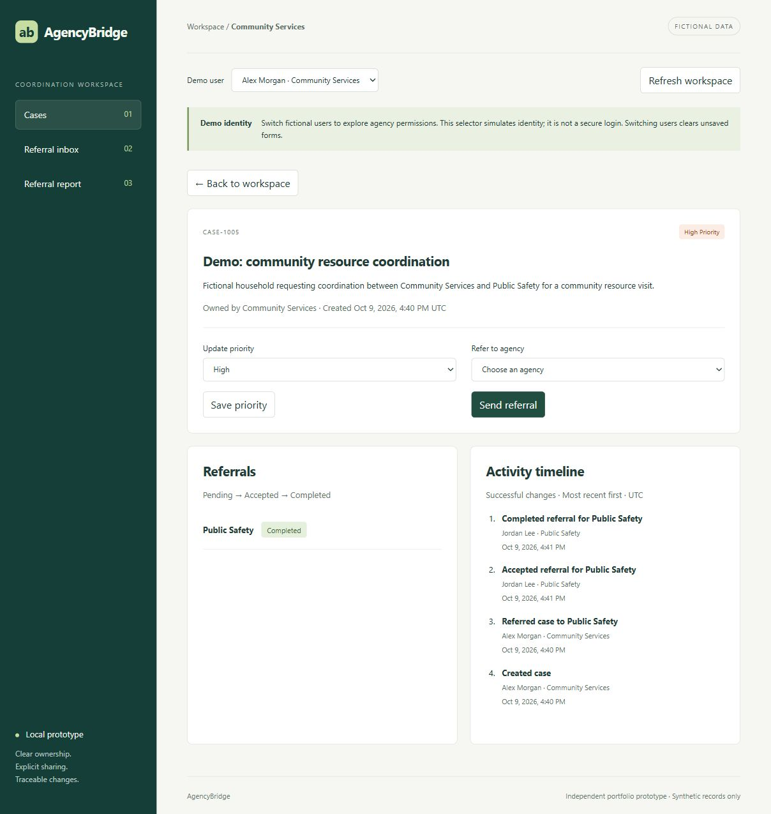

# AgencyBridge

A cross-agency referral prototype built with **React, TypeScript, FastAPI, and
SQLite**. It demonstrates explicit case sharing, agency-based authorization,
referral workflows, and transactional activity history using fictional data.

Project documentation date: **October 8, 2026**.



## What works now

- Select one of three fictional users, each belonging to a different agency.
- Create cases, filter accessible cases by priority, and look up a case by ID.
- Change priority and send referrals as the case's owning agency.
- Review incoming referrals and advance them pending → accepted → completed.
- Read a case and its history only as its owner or a referral recipient.
- Report on pending referrals sent by your agency, including zero-count recipients.
- Retry failed reads and retain creation drafts after validation/network errors.

**The demo selector simulates identity; it is not authentication.** Anyone running
the local prototype can select any fictional user or supply their demo header.
Backend authorization is enforced relative to that chosen identity. Use only
synthetic data; this prototype is not ready for secure production deployment.

## Get started

Tested with Python 3.14 and Node.js 24 (npm included). Git is required to clone.

```shell
git clone https://github.com/m-burns9203/agencybridge.git
cd agencybridge
```

### Windows (PowerShell)

Run the first-time setup from the cloned project folder:

```powershell
python -m venv .venv
.\.venv\Scripts\python.exe -m pip install -r backend\requirements-lock.txt
cd frontend
npm.cmd ci
cd ..
```

Terminal 1, from the project root:

```powershell
.\.venv\Scripts\python.exe -m uvicorn backend.main:app --reload --host 127.0.0.1 --port 8000
```

Terminal 2, from the project root:

```powershell
cd frontend
npm.cmd run dev
```

### macOS / Linux

From the cloned project folder, install dependencies:

```shell
python3 -m venv .venv
.venv/bin/python -m pip install -r backend/requirements-lock.txt
cd frontend
npm ci
cd ..
```

Start Python in one terminal from the project root:

```shell
.venv/bin/python -m uvicorn backend.main:app --reload --host 127.0.0.1 --port 8000
```

Start the frontend in a second terminal from the project root:

```shell
cd frontend
npm run dev
```

### Open the app

Open http://127.0.0.1:5173 for the app and http://127.0.0.1:8000/docs for the
interactive API documentation. Supply `x-demo-user-id` as 1, 2, or 3 on protected
endpoints. Stop manually started servers with Ctrl+C in their terminals. If the
app is already running, use it without starting another copy on the same ports.

The database is created automatically at `backend/agencybridge.sqlite3`. Startup
inserts missing demonstration records but does not duplicate or overwrite existing
records with those IDs. Existing first-milestone cases are preserved. Source
headers and seeds use October 8, 2026; new cases and events record actual UTC time.

## Verify

From the project root:

```powershell
.\.venv\Scripts\python.exe -m pytest backend -q
cd frontend
npm.cmd run build
```

The build checks TypeScript and produces browser assets. It does not start a
production server. Vite's API proxy is a development setting; deployment routing
is a later decision.

The backend suite covers agency isolation, forged ownership input, validation,
duplicate referrals, status transitions, report isolation, and rollback on audit
failure. It uses disposable databases. The installed test client emits an upstream
httpx deprecation warning; tests pass.

## Five-minute demonstration

1. Choose **Alex Morgan · Community Services** and create a fictional case.
2. Note its ID and send a referral to **Public Safety**.
3. Open **Referral report** to see the additional pending referral.
4. Switch to **Jordan Lee · Public Safety**, open **Referral inbox**, review the
   case, accept the referral, then complete it.
5. Switch to **Sam Rivera · School Support** and look up that ID. Access is denied.
6. Return to Alex, open the case, and explain the shared activity timeline.

The screenshot shows a case created through this flow. The local database is not
committed; a fresh clone starts with four fictional cases and no referrals.
Create a new case to rehearse the sequence from the beginning.

## Read the code in this order

1. `backend/schema.sql`: how records relate.
2. `backend/models.py`: accepted input and returned JSON.
3. `backend/database.py`: connections and fictional seed data.
4. `backend/main.py`: identity, permissions, endpoints, transactions, and reporting.
5. `frontend/src/api.ts`: request headers, shared types, and error messages.
6. `frontend/src/useApi.ts`: cancellable reads and stale-result prevention.
7. `frontend/src/App.tsx`: user selection, navigation, lists, and report.
8. `frontend/src/CaseForm.tsx`: case creation and form state.
9. `frontend/src/CaseDetails.tsx`: owner actions, recipient actions, and timeline.
10. `backend/test_workflow.py`: business rules expressed as executable checks.

Start with [the coordination walkthrough](docs/coordination-walkthrough.md) for
detailed explanations of the current code. The [first milestone guide](docs/first-milestone.md)
is historical and describes the initial read-only implementation.

## Intentional scope

There is no real login, deployment, external integration, attachment handling,
pagination, revocation, case deletion, or full case editing. Only priority is
editable. Refresh the workspace to fetch changes made in another browser tab.

Recipients can read the entire shared case, its referrals, and its timeline.
Completed referrals retain read access. History records successful mutations,
not views or denials. The API exposes no way to modify history, but the owner of
the database file can edit it directly. This is not tamper-proof auditing.

## Reference documentation

- [FastAPI first steps](https://fastapi.tiangolo.com/tutorial/first-steps/)
- [Vite getting started](https://vite.dev/guide/)
